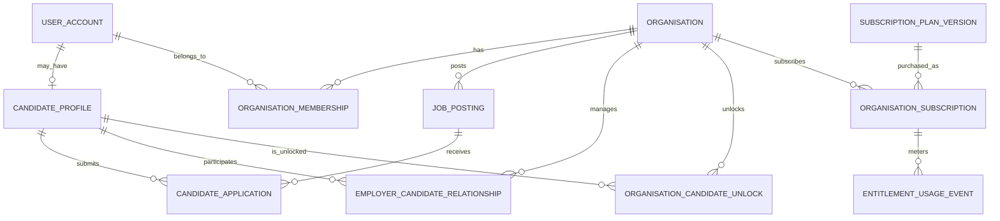
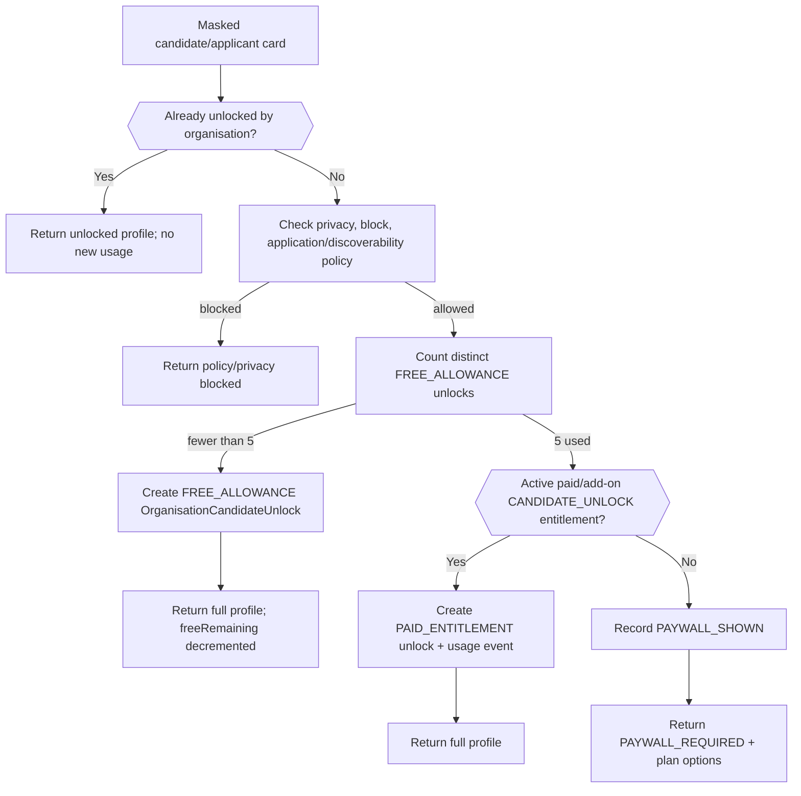

# IndiaWorks Unified SaaS Architecture v7

**Architecture freeze candidate - 25 September 2026**

## 1. Product model

IndiaWorks is a two-sided hiring marketplace/SaaS. Candidates use mobile OTP, structured job filters, job detail, save/share, alerts, one-tap applications and permitted direct employer contact. Employer organisations use verified identity, structured job posting, applicant management, a searchable candidate database, recruiting CRM, monthly/yearly subscriptions and job promotion.

### Commercial boundary

The organisation does **not** purchase unrestricted raw database access. It purchases entitlements. Before payment, a verified organisation can unlock **5 distinct candidate profiles** in total. The **6th distinct candidate is paywalled**.

Rules:

- masked candidate cards and applicant counts are free to view;
- only the first successful full-profile unlock of a distinct candidate consumes an unlock;
- the same candidate counts once across recruiters, jobs and access paths;
- the five-free allowance is organisation/legal-entity scoped and never resets;
- candidate privacy/block/consent is checked before paywall/entitlement;
- paid monthly/yearly/add-on plans can define additional `CANDIDATE_UNLOCK` quotas or unlimited access;
- contact reveal is a separate audited capability.

## 2. Unified domain relationship



## 3. Five-candidate paywall flow



## 4. Employer flow

1. OTP login / session / employer persona.
2. Create or select organisation; verify commercial identity where required.
3. Organisation receives free-evaluation candidate allowance = 5 distinct candidates.
4. Create structured job using Role -> Specialisation -> WorkContext and role template.
5. Capture vacancies, locations, compensation, shifts, benefits, requirements, contact windows, interview details and screening questions.
6. Moderation + publish entitlement checks.
7. Receive applications as masked cards and/or search candidate database as masked cards.
8. Unlock candidates 1-5 free organisation-wide.
9. Candidate 6: paywall if no active paid candidate-unlock entitlement.
10. Paid organisation searches/unlocks/reveals contact according to plan.
11. Recruiter CRM manages stage, owner, notes, tags, interviews and offers.
12. Optional job promotion applies only after relevance/eligibility.

## 5. Candidate flow

1. Mobile + OTP -> session -> jobs feed.
2. Optional city/role preferences; progressive profile only.
3. Search/filter by role, geo/radius, work mode, type, experience, education/course, pay, shift, freshness, urgency, language, skill, credential, asset, benefit and employer trust/source.
4. Open structured job detail.
5. Save/share using stable HTTPS deep link.
6. `prepareJobApplication` returns hard blocks/warnings/missing fields.
7. One-tap apply with snapshot/idempotency.
8. Call/message employer where contact policy permits.
9. Track application status.
10. Opt into alerts backed by saved searches and deduplicated delivery runs.

## 6. Job filter contract

The canonical `JobSearchInput` treats the following as independent dimensions: taxonomy (family/role/specialisation), work context, geography/radius, work mode, engagement type, experience, education level/course, compensation/pay frequency, bonus/incentive, shift, posted date, hiring urgency, languages, skills, credentials, assets, benefits, employer verification/source/sector/industry/company size and contact availability. Contextual facet counts are returned by `jobSearchFacets` from the derived job index.

## 7. Candidate access contract

`candidateSearch` and `jobApplicantsV7` return masked cards. `unlockCandidateProfile` is the only product operation that transitions an organisation-candidate pair to full professional profile access. The unique organisation+candidate DB key and idempotency key make the commercial boundary deterministic.

## 8. Subscription/entitlement model

Plans are immutable versioned products. Representative entitlements: `ACTIVE_JOBS`, `JOB_POSTS_PER_PERIOD`, `CANDIDATE_SEARCH`, `CANDIDATE_UNLOCK`, `CONTACT_REVEAL`, `RECRUITER_SEAT`, `PROMOTION_CREDIT`, `CV_DOWNLOAD`, `BULK_EXPORT`, `API_ACCESS`, `ADVANCED_ANALYTICS`.

`FREE_EVALUATION` uses `CANDIDATE_UNLOCK = 5` with `ResetCadence = NONE`. Paid monthly/yearly plans can reset paid quotas by billing period or define unlimited limit (`NULL`) while the original free allowance remains consumed permanently.

## 9. Candidate/employer relationship semantics

- Candidate-to-job: `CandidateApplication`.
- Organisation-to-candidate across jobs: `EmployerCandidateRelationship`.
- Commercial profile access: `OrganisationCandidateUnlock`.
- Contact access event: `CandidateContactReveal`.
- Candidate-to-organisation safety boundary: `CandidateOrganisationBlock`.

## 10. Search and ranking

Job and candidate search use derived projections. Canonical SQL remains normalized. Ranking order is hard eligibility -> structured relevance -> quality/freshness -> bounded paid promotion. Candidate PII and raw credential/identity numbers are excluded from search projections.

## 11. Job alerts

`SavedJobSearch` stores canonical filters/version; `JobAlertSubscription` stores channel/frequency/quiet hours; `JobAlertRun` stores watermark; `JobAlertDelivery` stores job/channel delivery dedupe and status.

## 12. Authentication/security

UserAccount is shared across candidate/employer personas. OTP is single-use with TTL, resend/attempt controls and provider audit. UserSession stores refresh-token hash/device/persona and supports rotation/revocation. Organisation RBAC and commercial entitlements are both required for protected employer operations.

## 13. GraphQL examples

```graphql
query CandidateAccessStatus($orgId: ID!) {{
  candidateAccessStatus(organisationId: $orgId) {{
    freeLimit freeUsed freeRemaining paywallActive paidAccessActive
  }}
}}

mutation Unlock($input: UnlockCandidateProfileInput!) {{
  unlockCandidateProfile(input: $input) {{
    decision
    source
    accessStatus {{ freeUsed freeRemaining paywallActive }}
    candidate {{ id displayName experienceMonths }}
    upgradePlanCodes
  }}
}}
```

## 14. Implementation dependency order

The approved architecture is delivered through the v9 implementation backlog:

S0 foundation -> S1 identity and authentication -> S2 organisation and taxonomy -> S3 billing and free-candidate gate -> S4 employer job authoring backend -> S5 employer job authoring UI -> S6 candidate profile -> S7 job search and matching backend -> S8 candidate job discovery UI -> S9 applications and alerts -> S10 employer applicant CRM -> S11 paid candidate database -> S12 promotion, notification and billing operations -> S13 trust, admin and analytics -> S14 hardening, UAT and launch.

The implementation backlog is topologically validated: no story depends on a later sprint or a later story within the same sprint; P0 stories precede P1/P2 within each sprint. The v7 SQL artifact remains a relationship reference only; EF Core code-first migrations are the production schema authority.
